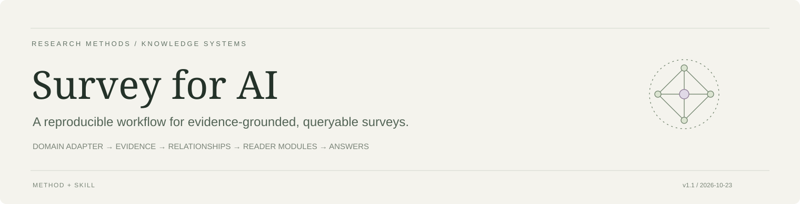
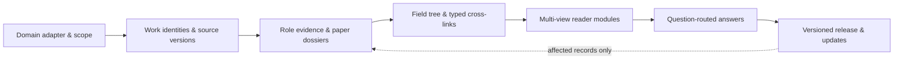
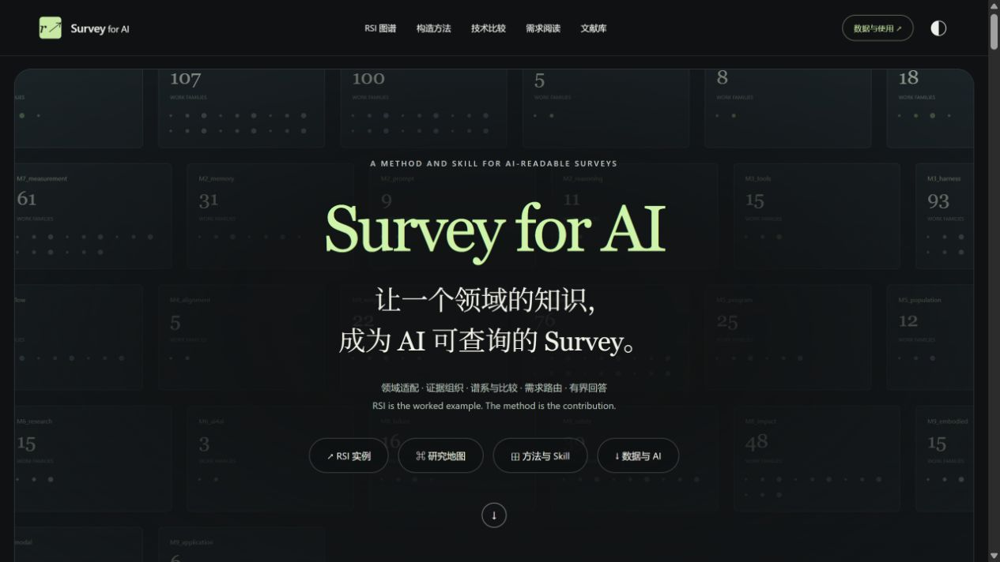

<div align="center">



# Survey for AI

### A reusable method and Skill for building surveys that AI can read, query and maintain.

**English** · [简体中文](README_CN.md)

[Explore the live example](https://mr-tieguigui.github.io/survey-for-ai/) · [Use the Skill](skill/survey-evidence-ledger/SKILL.md) · [Method contract](method/workflow.json) · [AI reading guide](AI_GUIDE.md)

  

</div>

**Survey for AI turns a literature collection into a structured knowledge system for AI readers.** The main contribution is a domain-adaptable construction method, a reusable Skill, and a retrieval contract: an agent should locate the knowledge it needs, understand its boundaries, and trace an answer to the right source version without rereading an entire field.

**Recursive self-improvement (RSI) is the current worked example.** The workflow is designed for other domains through an explicit adapter. The current release demonstrates one domain; it does not establish universal effectiveness, measured token savings, or complete coverage of every paper in the world.

> **The unit of delivery is a reusable knowledge system:** paper dossiers + versioned evidence + field relationships + reader modules + bounded answers. A website presents it; a narrative article can later be written from it.

## Start with your goal

| I want to… | Start here | What I get |
|---|---|---|
| Understand the idea | [Construction method](#the-construction-method) | Lifecycle, evidence permissions and completion gates |
| Build a survey in another field | [New-domain quick start](#build-a-survey-in-another-domain) | An empty adapter-driven workspace and an agent workflow |
| Give an existing survey to an AI | [AI_GUIDE.md](AI_GUIDE.md) | Authority order, targeted retrieval and citation rules |
| Explore a finished example | [RSI research atlas](https://mr-tieguigui.github.io/survey-for-ai/#atlas) | Vertical branches, typed relations, comparisons and reader routes |
| Inspect a paper | [808-paper library](https://mr-tieguigui.github.io/survey-for-ai/explore/) | Concrete content, protocol, limitations, links and evidence depth |
| Download all RSI information | [Complete knowledge ZIP — access required](https://github.com/Mr-Tieguigui/rsi-survey/raw/refs/heads/main/survey/RSI-Survey-Knowledge.zip) | Canonical data, 808 Markdown dossiers, screening, methods and query tools |

## Why a survey for AI?

A long document is useful for reading from beginning to end. An AI answering a specific research question also needs to know **which record to retrieve, which version supports it, what can be compared, and when the evidence is insufficient**.

This method preserves those decisions as explicit data:

| Reader need | Knowledge representation | What the AI can do |
|---|---|---|
| “What does this paper actually do?” | Role-specific dossier + optional configuration | Retrieve mechanism, setup, results and limits together |
| “How did this direction develop?” | Branch navigation + typed directed relations | Follow supported transitions; distinguish comparison from inheritance |
| “Which approaches should I compare?” | Domain-defined comparison axes + protocol conditions | Compare compatible settings and keep missing cells visible |
| “What matters for my task?” | Reader goal → question → module | Read the relevant slice rather than all papers |
| “Can I cite this statement?” | Admitted claim → source/version/locator | Return a bounded statement with a traceable citation |
| “What changed after a new paper?” | Versioned records + reverse dependencies | Repair affected modules and answers without rebuilding knowledge from scratch |

The design targets less repeated reading and more precise retrieval. Those are architectural goals; controlled accuracy, time and token comparisons remain an evaluation task.

## The construction method



| Step | Build | Acceptance gate |
|---|---|---|
| **01 · Define the domain** | Operational definition, roles, inclusions/exclusions, search sources/cutoff, reader goals and budget | Freeze the unit of membership and the release scope before bulk expansion |
| **02 · Resolve identities** | Work families, aliases, DOI/arXiv identities and separate source manifestations | Similar titles are candidate links; preserve ambiguous identity and earlier versions |
| **03 · Read for evidence** | Concrete paper dossiers; bounded role claims; optional method/protocol configurations | Admit a technical statement only from its relevant primary-body support; record URL, version, locator and limits |
| **04 · Map the field** | A navigable branch tree plus typed relationships across branches | Resolve endpoints and support the actual relation; a citation or timeline alone is not inheritance |
| **05 · Synthesize by need** | Vertical, horizontal, mechanism, frontier and reader modules | Every module exposes its supporting claim IDs, conditions, interpretation and gaps |
| **06 · Answer with bounds** | A small evidence packet selected by question | Cite the actual version; distinguish supported, partial and insufficient-evidence answers |
| **07 · Maintain and release** | Dependency-aware updates, integrity checks and a versioned manifest | Preserve membership/history, resolve references and report remaining gates |

The machine-readable lifecycle is [method/workflow.json](method/workflow.json). The [domain interface](method/domain_interface.json) defines interchangeable view inputs; the [data contract](skill/survey-evidence-ledger/references/data-contract.md) explains their semantics.

### Evidence is not one binary badge

`discovered → screened → source available → selected passage reviewed → bounded claim admitted`

These states answer different questions. Metadata supports identity/navigation; an abstract supports screening/context; a reviewed passage supports its exact interpretation; an admitted claim permits a bounded technical citation. A benchmark or a survey can provide useful role evidence without receiving an iterative-method configuration.

Keep **organization-ready**, **strict-primary-review-complete**, and **method-effectiveness-validated** separate. An unresolved paper stays visible; it does not disappear to make a progress bar reach 100%.

## One knowledge base, several ways to understand a field

<table>
<tr><th>View</th><th>Question it serves</th><th>Construction rule</th></tr>
<tr><td><b>Vertical development</b></td><td>What changed, why, and what followed?</td><td>Organize branches; connect supported problem/mechanism transitions; retain multiple parents where evidence requires them.</td></tr>
<tr><td><b>Horizontal comparison</b></td><td>How do neighboring approaches differ?</td><td>Choose domain-specific axes. Preserve task, split, metric, budget and selection differences before comparing scores.</td></tr>
<tr><td><b>Mechanism</b></td><td>How does a system or method work?</td><td>Connect inputs, process, outputs, assumptions and failure modes. Add state/feedback only for relevant systems.</td></tr>
<tr><td><b>Frontier</b></td><td>What are the latest observed leaves and open problems?</td><td>Use the frozen search scope and cutoff. Several leaves may coexist; a local leaf is not proof of global novelty.</td></tr>
<tr><td><b>Reader demand</b></td><td>What should a newcomer, researcher, builder or evaluator read?</td><td>Map goals to questions, modules, evidence and optional deeper reading.</td></tr>
<tr><td><b>Question answering</b></td><td>What can the present evidence actually answer?</td><td>Return the claim, applicable conditions, citations, limits and missing evidence; abstain when necessary.</td></tr>
</table>

The **tree is an entry point**. Typed cross-links preserve the relationships that a single-parent tree cannot express. Grouping, chronology, curator comparison and evidenced technical inheritance remain distinct.

## Build a survey in another domain

The distributable Skill is [survey-evidence-ledger](skill/survey-evidence-ledger/SKILL.md). It includes concise operating instructions, a domain-neutral initializer, a contract validator, synthesis guidance, an evaluation protocol and a separate RSI adapter.

**1. Obtain the method and Skill.** Clone this public distribution, or download the repository ZIP. An agent can read the Skill directly from the checked-out directory; no provider-specific installation is required for that usage.

```bash
git clone https://github.com/Mr-Tieguigui/survey-for-ai.git
cd survey-for-ai
python skill/survey-evidence-ledger/scripts/init_domain.py \
  --output ../my-survey --domain-id my-domain \
  --name "My research field" --scope "My explicit research question and boundaries"
```

**2. Fill the adapter.** `../my-survey/method/domain_adapter.json` defines the vocabulary and acceptance criteria. Set inclusion/exclusion, search sources/cutoff, role-specific evidence fields, comparison axes, relation predicates, readers/questions and budget. The initializer creates an empty **draft**; it does not fabricate a corpus or count reviews as completed.

**3. Give the agent an explicit job.**

```text
Read skill/survey-evidence-ledger/SKILL.md and use it to build ../my-survey.
Start by completing the domain adapter and locking the scope with the available information.
Use real sources, preserve exact identities and versions, and label evidence depth.
Build paper dossiers, a branch tree with typed cross-links, comparisons and reader modules.
Route answers through admitted claims. Keep gaps visible and resume from saved state.
Use deterministic tools for joins and checks; keep model context limited to the needed evidence.
```

**4. Curate, synthesize and check.** The agent performs the semantic work with available sources/tools. The exported-domain checker verifies identifiers and references, not scientific truth:

```bash
python skill/survey-evidence-ledger/scripts/validate_release.py ../my-survey/catalog
```

An empty scaffold intentionally fails release readiness. A different domain supplies its own schema mapping and evidence requirements. The initializer and generic contract are portable; the complete RSI website builder and its current data projection remain a case-specific implementation.

<details>
<summary><b>What should change when moving to another field?</b></summary>

| Adapt | Preserve |
|---|---|
| Terminology and inclusion/exclusion | Stable work identities and observed source versions |
| Paper roles and mechanism/evaluation fields | Role-appropriate primary support and explicit unknowns |
| Comparison axes and protocol compatibility | Bounded statements, citation permission and limits |
| Relationship vocabulary and branch taxonomy | Supported endpoints; no chronology-to-inheritance shortcut |
| Reader profiles, questions and module structure | Question routing and traceable answers |
| Search sources, cutoff, update cadence and budget | Versioned state, incremental repair and honest completion gates |

For example, a retrieval-method survey and a materials-process survey may use completely different mechanism and evaluation dimensions. These are adapter design examples, not completed cross-domain experiments.

</details>

## How an AI uses the resulting survey

**Retrieval path:** `reader request → question index → module → admitted claims → source locators → optional dossier/passages`.

For the complete RSI package, the offline tools provide targeted retrieval without a model or network call:

```bash
python scripts/query.py "Darwin" --type papers --limit 3
python scripts/dossier.py wf_c29f716871f8031486
python scripts/dossier.py wf_c29f716871f8031486 --excerpts
```

Run these inside the extracted **RSI knowledge package**; the public showcase does not include its private canonical catalog. The joint query returns work identity, configurations, admitted claims, relationships, sources, limits and separately labeled reading notes. Excerpts are expanded only when requested.

An answer packet records:

```text
question / corpus_version / answer
claim_ids / citations {url, version, locator}
comparison_conditions / limits / gaps
status: supported | partial | insufficient_evidence
```

**Concrete example:** a reader asks whether changing an agent's code also changes the mechanism that generates future improvements. The RSI route retrieves the DGM and Hyperagents configurations and relation `r_hyper_dgm`; it compares the documented boundaries and selection conditions rather than treating every “self-improving” title as equivalent. See the [live comparison](https://mr-tieguigui.github.io/survey-for-ai/#compare) and [DGM dossier](https://mr-tieguigui.github.io/survey-for-ai/papers/wf_c29f716871f8031486/).

## RSI: the worked example

| Current fixed snapshot | Count | Interpretation |
|---|---:|---|
| Work families / Markdown dossiers | **808** | Role-classified identities and reading views; not 808 certified full-paper reviews |
| Method configurations | **256** | Configuration-specific boundaries and protocols |
| Admitted claims | **745** | Bounded claims under their recorded citation permissions |
| Typed relations | **198** | 197 currently marked primary-supported for display |
| Branches / reader modules | **26 / 38** | Complementary organization and question routes |
| Source / evidence records | **1,207 / 1,262** | Mixed depths and historical records retained |
| Dossiers with saved selected passages | **509** | Source transcripts stay in the access-controlled package; public views retain locators |
| Dossiers with saved evaluation details | **241** | Coverage of recorded protocol fields, not independent reproduction |
| Strict primary-review plan | **533 / 570** | **37 source/version/locator exceptions remain** |

The candidate ledger contains 28,393 discovery records and 1,072 historical P1 screening items. Those are discovery/screening denominators, not extra admitted papers. Six targeted descriptive reading notes enrich specific mechanisms and protocols without becoming six whole-paper reviews.



## Low-cost operation and honest evaluation

Read compact state and the current changes first. Reuse exact URL/version caches; extract a needed passage once; use identifiers to reuse it across views. Let scripts perform counting, joins, hashing and link checks. Keep semantic work for identity ambiguity, mechanism interpretation, conflicting evidence and relation meaning. Review changed fields rather than rereading every paper. Update only affected dependencies and batch accepted changes before rebuilding.

No numeric efficiency claim is made. The [evaluation protocol](skill/survey-evidence-ledger/references/evaluation-protocol.md) specifies same-model/same-source comparisons, ablations, unexposed transfer cases, citation fidelity, answer utility, source reads, tokens, elapsed time and incremental repair. Passing a schema check is not evidence that a model became more accurate.

## Files, access and maintenance

| Distribution | Contains | Access |
|---|---|---|
| [Public method + website](https://github.com/Mr-Tieguigui/survey-for-ai) | Bilingual introduction, Skill, method contracts, website source and rendered RSI example | Public |
| [Complete knowledge repository](https://github.com/Mr-Tieguigui/rsi-survey) | Canonical corpus, evidence, dossiers, screening, indexes, private information ZIP and full build inputs | Access-controlled |
| [Standalone RSI ZIP](https://github.com/Mr-Tieguigui/rsi-survey/raw/refs/heads/main/survey/RSI-Survey-Knowledge.zip) | All integrated Survey knowledge; **no website, GitHub settings, full PDFs or raw caches** | Repository access required |

The full knowledge package is arranged as `catalog/`, `papers/`, `indexes/`, `screening/`, `method/`, `skill/`, `metadata/` and offline query tools. Its internal manifest records content hashes. The public showcase is a generated reading view; it does not create new evidence admissions or distribute source-document transcripts.

For changes, first identify the source version and affected claims/modules. Preserve earlier records and unresolved conflicts, validate the changed slice plus references, and update the release manifest last. A useful contribution includes a work/source ID, exact locator, proposed bounded correction, and affected reader route.

**Status and rights.** The method and Skill are an implemented candidate, not a universally validated research result. No short paper is being written in this update. Public availability does not assign a new license to original code, analysis, metadata or third-party material; see [LICENSE_STATUS.md](LICENSE_STATUS.md).

**Presentation reference.** The method-led introduction, clear entry points and progressive detail were inspired by [ARIS](https://github.com/wanshuiyin/Auto-claude-code-research-in-sleep); the workflow, diagrams and Survey content here are project-specific. The example website also draws presentation inspiration from [Ropedia W0](https://ropedia.github.io/ropedia-w0/).
