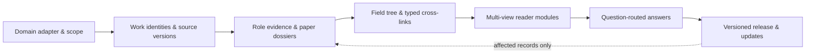

<div align="center">


# Survey for AI

### A reusable method and Skill for building surveys that AI can read, query and maintain.

**English** · [简体中文](README_CN.md)

[Explore the live example](https://mr-tieguigui.github.io/survey-for-ai/en/) · [Use the Skill](skill/survey-evidence-ledger/SKILL.md) · [Method contract](method/workflow.json) · [AI reading guide](AI_GUIDE.md) · [Add a Survey](#build-a-survey-in-another-domain) · [Frontier directory](#frontier-directory)

  

</div>

**Survey for AI turns a literature collection into a structured knowledge system for AI readers.** The main contribution is a domain-adaptable construction method, a reusable Skill, and a retrieval contract: an agent should locate the knowledge it needs, understand its boundaries, and trace an answer to the right source version without rereading an entire field.

**Recursive self-improvement (RSI) is the current worked example.** The workflow is designed for other domains through an explicit adapter. The current release demonstrates one domain; it does not establish universal effectiveness, measured token savings, or complete coverage of every paper in the world.

> **The unit of delivery is a reusable knowledge system:** paper dossiers + versioned evidence + field relationships + reader modules + bounded answers. A website presents it; a narrative article can later be written from it.

<p align="center"><sub>◈ Method + Skill &nbsp; · &nbsp; ◎ RSI worked example &nbsp; · &nbsp; Release v1.1.0 &nbsp; · &nbsp; Presentation updated 2026-10-23</sub></p>

## Research at a glance

| ◇ Framework | ⌘ Reusable Skill | ◎ Worked example | ↔ Bilingual interface |
|---|---|---|---|
| Domain adapter, evidence permissions, typed relations and answer contract | Initialize, curate, synthesize, retrieve and maintain | Fixed RSI corpus, with explicit evidence depth | [English website](https://mr-tieguigui.github.io/survey-for-ai/en/) · [中文网站](https://mr-tieguigui.github.io/survey-for-ai/) |

<figure>

</figure>

*Figure 1. A conceptual construction and retrieval model. The shaded evidence boundary distinguishes navigational context from technical citation permission; the return path represents selective maintenance, not a measured speedup.*

## Start with your goal

| I want to… | Start here | What I get |
|---|---|---|
| Understand the idea | [Construction method](#the-construction-method) | Lifecycle, evidence permissions and completion gates |
| Build a survey in another field | [New-domain quick start](#build-a-survey-in-another-domain) | An empty adapter-driven workspace and an agent workflow |
| Give an existing survey to an AI | [AI_GUIDE.md](AI_GUIDE.md) | Authority order, targeted retrieval and citation rules |
| Choose or propose a new direction | [Frontier directory](#frontier-directory) | Six proposed scopes, open ownership and a reusable template |
| Explore a worked example | [RSI research atlas](https://mr-tieguigui.github.io/survey-for-ai/en/atlas/) | Vertical branches, typed relations, comparisons and reader routes |
| Inspect a paper | [808-paper library](https://mr-tieguigui.github.io/survey-for-ai/en/explore/) | Concrete content, protocol, limitations, links and evidence depth |
| Download all RSI information | [Complete knowledge ZIP — access required](https://github.com/Mr-Tieguigui/rsi-survey/raw/refs/heads/main/survey/RSI-Survey-Knowledge.zip) | Canonical data, 808 Markdown dossiers, screening, methods and query tools |

## Why a survey for AI?

A long document is useful for reading from beginning to end. An AI answering a specific research question also needs to know **which record to retrieve, which version supports it, what can be compared, and when the evidence is insufficient**.

This method preserves those decisions as explicit data:

| Reader need | Knowledge representation | What the AI can do |
|---|---|---|
| “What does this paper actually do?” | Role-specific dossier + optional configuration | Retrieve mechanism, setup, results and limits together |
| “How did this direction develop?” | Branch navigation + typed directed relations | Follow supported transitions; distinguish comparison from inheritance |
| “Which approaches should I compare?” | Domain-defined comparison axes + protocol conditions | Compare compatible settings and keep missing cells visible |
| “What matters for my task?” | Reader goal → question → module | Read the relevant slice rather than all papers |
| “Can I cite this statement?” | Admitted claim → source/version/locator | Return a bounded statement with a traceable citation |
| “What changed after a new paper?” | Versioned records + reverse dependencies | Repair affected modules and answers without rebuilding knowledge from scratch |

The design targets less repeated reading and more precise retrieval. Those are architectural goals; controlled accuracy, time and token comparisons remain an evaluation task.

## The construction method



| Step | Build | Acceptance gate |
|---|---|---|
| **01 · Define the domain** | Operational definition, roles, inclusions/exclusions, search sources/cutoff, reader goals and budget | Freeze the unit of membership and the release scope before bulk expansion |
| **02 · Resolve identities** | Work families, aliases, DOI/arXiv identities and separate source manifestations | Similar titles are candidate links; preserve ambiguous identity and earlier versions |
| **03 · Read for evidence** | Concrete paper dossiers; bounded role claims; optional method/protocol configurations | Admit a technical statement only from its relevant primary-body support; record URL, version, locator and limits |
| **04 · Map the field** | A navigable branch tree plus typed relationships across branches | Resolve endpoints and support the actual relation; a citation or timeline alone is not inheritance |
| **05 · Synthesize by need** | Vertical, horizontal, mechanism, frontier and reader modules | Every module exposes its supporting claim IDs, conditions, interpretation and gaps |
| **06 · Answer with bounds** | A small evidence packet selected by question | Cite the actual version; distinguish supported, partial and insufficient-evidence answers |
| **07 · Maintain and release** | Dependency-aware updates, integrity checks and a versioned manifest | Preserve membership/history, resolve references and report remaining gates |

The machine-readable lifecycle is [method/workflow.json](method/workflow.json). The [domain interface](method/domain_interface.json) defines interchangeable view inputs; the [data contract](skill/survey-evidence-ledger/references/data-contract.md) explains their semantics.

### Evidence is not one binary badge

`discovered → screened → source available → selected passage reviewed → bounded claim admitted`

These states answer different questions. Metadata supports identity/navigation; an abstract supports screening/context; a reviewed passage supports its exact interpretation; an admitted claim permits a bounded technical citation. A benchmark or a survey can provide useful role evidence without receiving an iterative-method configuration.

Keep **organization-ready**, **strict-primary-review-complete**, and **method-effectiveness-validated** separate. An unresolved paper stays visible; it does not disappear to make a progress bar reach 100%.

## One knowledge base, several ways to understand a field

<table>
<tr><th>View</th><th>Question it serves</th><th>Construction rule</th></tr>
<tr><td><b>Vertical development</b></td><td>What changed, why, and what followed?</td><td>Organize branches; connect supported problem/mechanism transitions; retain multiple parents where evidence requires them.</td></tr>
<tr><td><b>Horizontal comparison</b></td><td>How do neighboring approaches differ?</td><td>Choose domain-specific axes. Preserve task, split, metric, budget and selection differences before comparing scores.</td></tr>
<tr><td><b>Mechanism</b></td><td>How does a system or method work?</td><td>Connect inputs, process, outputs, assumptions and failure modes. Add state/feedback only for relevant systems.</td></tr>
<tr><td><b>Frontier</b></td><td>What are the latest observed leaves and open problems?</td><td>Use the frozen search scope and cutoff. Several leaves may coexist; a local leaf is not proof of global novelty.</td></tr>
<tr><td><b>Reader demand</b></td><td>What should a newcomer, researcher, builder or evaluator read?</td><td>Map goals to questions, modules, evidence and optional deeper reading.</td></tr>
<tr><td><b>Question answering</b></td><td>What can the present evidence actually answer?</td><td>Return the claim, applicable conditions, citations, limits and missing evidence; abstain when necessary.</td></tr>
</table>

The **tree is an entry point**. Typed cross-links preserve the relationships that a single-parent tree cannot express. Grouping, chronology, curator comparison and evidenced technical inheritance remain distinct.

## Build a survey in another domain

**Choose a direction → initialize a draft → adapt the evidence contract → curate → synthesize → validate and release.** The same method and [Skill](skill/survey-evidence-ledger/SKILL.md) support this lifecycle; the new field supplies its own definitions, evidence fields and comparison criteria.

### 1 · Choose an open direction or define your own

Browse the [frontier directory](frontiers/README.md). Each proposed topic has its own scope file and first-party discovery links. For an unlisted field, copy [`frontiers/_template/`](frontiers/_template/) to `frontiers/<domain-id>/`, edit `scope.json`, and add its relative path to [`registry.json`](frontiers/registry.json). Use a lowercase ID with letters, digits and hyphens. These proposals are starting points, with **zero completed primary reviews**, not completed surveys.

### 2 · Create the actual survey workspace

Run from the repository root after cloning:

```bash
git clone https://github.com/Mr-Tieguigui/survey-for-ai.git
cd survey-for-ai
python skill/survey-evidence-ledger/scripts/init_domain.py \
  --output frontiers/agent-memory/survey --domain-id agent-memory \
  --name "Agent Memory" --scope "External agent memory: retention, retrieval and cross-task evaluation"
```

Replace the ID, name, question and output for your field. Keep the proposal in its parent folder; its `survey/` child holds the actual research records. The initializer accepts a new or empty target and preserves an existing survey by refusing to overwrite it. Running it does **not** retrieve papers, admit claims or create a website.

### 3 · Adapt the domain contract before bulk collection

Edit `frontiers/agent-memory/survey/method/domain_adapter.json`:

| Decide | Record in the adapter | Agent-memory example — proposed scope |
|---|---|---|
| What belongs? | Definition, inclusion/exclusion, sources and cutoff | Distinguish external retained state from model-weight training |
| What must each paper support? | Method, benchmark, theory and background evidence fields | Memory representation, write/read rules, retention, evaluation and limits |
| What can be compared? | Comparison axes and compatible protocols | Cross-task split, base model, context, tools and compute budget |
| How do works connect? | Branch vocabulary and typed relation rules | Separate comparison, shared mechanisms and supported technical inheritance |
| Who will use it? | Reader profiles and answerable questions | Builder: which state and retrieval policy fit a task? |
| What is the release scope? | Budget, completion unit and audience | Lock the corpus and evidence target; record unresolved cases separately |

A proposal's `scope.json` is planning input. The initialized adapter is the execution contract; `catalog/` and saved evidence decide what is supported. Overlap with RSI does not automatically transfer claim permission or increase its membership.

### 4 · Give an AI a concrete task

Let the agent read the checked-out Skill directly; this does not require a provider-specific installation command. Start with a small pilot to verify the fields, then lock the batch scope.

```text
Read skill/survey-evidence-ledger/SKILL.md.
Build frontiers/agent-memory/survey using frontiers/agent-memory/scope.json as planning input.
Complete the domain adapter and explicitly record scope, sources, cutoff and budget.
Use real identities, exact source versions, role-specific evidence and material limits.
Keep discovery links separate from admitted technical claims; do not invent papers or results.
Build dossiers, branches, typed cross-links, comparison axes and reader modules.
Return bounded answers with claim IDs, citations, conditions and unresolved gaps.
Resume from work/run_state.json; reuse saved evidence and update only affected records.
```

### 5 · Produce knowledge that both people and AI can inspect

```text
frontiers/<domain-id>/
├── scope.json                  # Proposed direction and discovery links
├── README.md                   # Generated bilingual direction brief
└── survey/                     # Created only when research starts
    ├── method/domain_adapter.json
    ├── catalog/                # Works, versions, evidence, claims, relations and modules
    ├── papers/                 # Concrete per-paper dossiers
    ├── indexes/                # Reader and question routes
    └── work/run_state.json     # Resumable state and unresolved decisions
```

### 6 · Validate, then promote the status

```bash
python skill/survey-evidence-ledger/scripts/validate_release.py frontiers/agent-memory/survey/catalog
python scripts/build_frontier_index.py
python scripts/build_frontier_index.py --check
```

The first command checks the generic data contract and references; an empty draft intentionally fails readiness. Scientific accuracy still requires role-appropriate evidence review and semantic checks of relations and answers. The latter commands refresh and verify the bilingual directory without model or network calls. Promote `scope.json` through `proposed → scoped → curating → synthesizing → ready` only when the corresponding work exists. Record scope/cutoff, evidence depth and unresolved items at release.

**Website integration is a separate step.** The reusable initializer and data contracts are domain-neutral. The current RSI website projection is case-specific and needs a field-specific data/view adapter for another survey. Publishing or making a new corpus public requires its own audience decision.

<a id="frontier-directory"></a>

## Frontier surveys · open extension directory

These are **curator-proposed future surveys**, not a ranked list of the newest fields or completed cross-domain validations. Seed URLs were checked on **2026-10-23** as first-party discovery entry points; they do not certify primary-body review or establish a literature cutoff. All six slots are unassigned and can be revised before scope lock.

<!-- frontier-directory:start -->
| ID | Proposed survey | Research question | Status | Directory |
|---|---|---|---|---|
| F01 | Agent memory & continual learning | How does external memory affect later tasks, and how is transfer evaluated? | ○ Proposed | [agent-memory](frontiers/agent-memory/) |
| F02 | Test-time compute, reasoning & adaptation | What changes with inference compute versus test-time updates? | ○ Proposed | [test-time-adaptation](frontiers/test-time-adaptation/) |
| F03 | Scientific discovery & research agents | Which steps from a research question to a candidate result are verifiable? | ○ Proposed | [scientific-discovery](frontiers/scientific-discovery/) |
| F04 | World models & embodied interaction | What do generative, predictive and interactive environment models support? | ○ Proposed | [world-models](frontiers/world-models/) |
| F05 | Agent evaluation & reliability | How can model, environment, harness and protocol contributions be separated? | ○ Proposed | [agent-evaluation](frontiers/agent-evaluation/) |
| F06 | Multi-agent coordination & organization | How does coordination affect decomposition, communication and outcomes? | ○ Proposed | [multi-agent-systems](frontiers/multi-agent-systems/) |
| ＋ | **Your domain** | Define the scope and reader questions | Open slot | [_template](frontiers/_template/) |
<!-- frontier-directory:end -->

**Your field is welcome.** Use the open template row for an additional AI or non-AI domain. Details and contribution steps: [English directory](frontiers/README.md) · [中文目录](frontiers/README_CN.md) · [Machine registry](frontiers/registry.json). Keep the RSI worked example and each future survey in separate versioned scopes.

## How an AI uses the resulting survey

**Retrieval path:** `reader request → question index → module → admitted claims → source locators → optional dossier/passages`.

For the complete RSI package, the offline tools provide targeted retrieval without a model or network call:

```bash
python scripts/query.py "Darwin" --type papers --limit 3
python scripts/dossier.py wf_c29f716871f8031486
python scripts/dossier.py wf_c29f716871f8031486 --excerpts
```

Run these inside the extracted **RSI knowledge package**; the public showcase does not include its private canonical catalog. The joint query returns work identity, configurations, admitted claims, relationships, sources, limits and separately labeled reading notes. Excerpts are expanded only when requested.

An answer packet records:

```text
question / corpus_version / answer
claim_ids / citations {url, version, locator}
comparison_conditions / limits / gaps
status: supported | partial | insufficient_evidence
```

**Concrete example:** a reader asks whether changing an agent's code also changes the mechanism that generates future improvements. The RSI route retrieves the DGM and Hyperagents configurations and relation `r_hyper_dgm`; it compares the documented boundaries and selection conditions rather than treating every “self-improving” title as equivalent. See the [live comparison](https://mr-tieguigui.github.io/survey-for-ai/en/compare/) and [DGM dossier](https://mr-tieguigui.github.io/survey-for-ai/en/papers/wf_c29f716871f8031486/).

## Representative papers and what each demonstrates

The selection below illustrates different roles and mechanisms, rather than ranking papers or certifying all-paper review. Versions link to the sources actually recorded in this release.

| Year | Paper / actual source | Research role | Retained object / reading boundary |
|---|---|---|---|
| 2003 | [Gödel Machine](https://arxiv.org/html/cs/0309048v5) · `v5` | Theory / formal system | Provable rewriting under stated formal and utility assumptions |
| 2025 | [Absolute Zero](https://arxiv.org/html/2505.03335v3) · `v3` | Method | Shared-policy learning; task buffers and parameters |
| 2023 | [Voyager](https://arxiv.org/html/2305.16291v2) · `v2` | Method | Executable skills across later tasks |
| 2023 | [ExpeL](https://arxiv.org/html/2308.10144v3) · `v3` | Method | Experience rules retrieved in later prompts |
| 2024 | [ADAS](https://arxiv.org/html/2408.08435v2) · `v2` | System / agent | Archived target-agent designs; fixed meta-agent |
| 2025 | [SICA](https://arxiv.org/html/2504.15228v2) · `v2` | Method | Archived coding agents selected for later improvement |
| 2025 | [Darwin Gödel Machine](https://arxiv.org/html/2505.22954v3) · `v3` | Method | Agent-code evolution; empirical evaluation rather than formal proof |
| — | [Raven](https://github.com/EverMind-AI/Raven/releases/download/tech-report-v1/technical-report.pdf) · `tech-report-v1` | System / agent | Harness strategy adaptation; training selection separate from sealed tests |


*Figure 2. The display runs from predecessor to successor; ledger predicates and relation IDs are preserved. Neither edge is evidence of universal RSI or sustained acceleration.*

## RSI: the worked example

| Current fixed snapshot | Count | Interpretation |
|---|---:|---|
| Work families / Markdown dossiers | **808** | Role-classified identities and reading views; not 808 certified full-paper reviews |
| Method configurations | **256** | Configuration-specific boundaries and protocols |
| Admitted claims | **745** | Bounded claims under their recorded citation permissions |
| Typed relations | **198** | 197 currently marked primary-supported for display |
| Branches / reader modules | **26 / 38** | Complementary organization and question routes |
| Source / evidence records | **1,207 / 1,262** | Mixed depths and historical records retained |
| Dossiers with saved selected passages | **509** | Source transcripts stay in the access-controlled package; public views retain locators |
| Dossiers with saved evaluation details | **241** | Coverage of recorded protocol fields, not independent reproduction |
| Strict primary-review plan | **533 / 570** | **37 source/version/locator exceptions remain** |

The candidate ledger contains 28,393 discovery records and 1,072 historical P1 screening items. Those are discovery/screening denominators, not extra admitted papers. Six targeted descriptive reading notes enrich specific mechanisms and protocols without becoming six whole-paper reviews.


## Low-cost operation and honest evaluation

Read compact state and the current changes first. Reuse exact URL/version caches; extract a needed passage once; use identifiers to reuse it across views. Let scripts perform counting, joins, hashing and link checks. Keep semantic work for identity ambiguity, mechanism interpretation, conflicting evidence and relation meaning. Review changed fields rather than rereading every paper. Update only affected dependencies and batch accepted changes before rebuilding.

No numeric efficiency claim is made. The [evaluation protocol](skill/survey-evidence-ledger/references/evaluation-protocol.md) specifies same-model/same-source comparisons, ablations, unexposed transfer cases, citation fidelity, answer utility, source reads, tokens, elapsed time and incremental repair. Passing a schema check is not evidence that a model became more accurate.

## Release and reading map

| Date | Version / scope | What changed |
|---|---|---|
| 2026-10-23 | Framework v1.1.0 | Evidence Atlas identity, unified vertical 01–10 navigation, scroll transitions, bilingual README and new-survey extension directory |
| Fixed corpus | RSI snapshot | 808 families and existing evidence permissions retained; presentation changes do not count as new reviews |

Read in order: **[Framework](https://mr-tieguigui.github.io/survey-for-ai/en/) → [Method](https://mr-tieguigui.github.io/survey-for-ai/en/method/) → [Skill](https://mr-tieguigui.github.io/survey-for-ai/en/skill/) → [RSI overview](https://mr-tieguigui.github.io/survey-for-ai/en/rsi/) → [Atlas](https://mr-tieguigui.github.io/survey-for-ai/en/atlas/) → [Cases](https://mr-tieguigui.github.io/survey-for-ai/en/cases/) → [Comparison](https://mr-tieguigui.github.io/survey-for-ai/en/compare/) → [Reader questions](https://mr-tieguigui.github.io/survey-for-ai/en/reader/)**. The language switch preserves the current page. Interfaces and selected briefs are bilingual; archival dossiers retain their original curatorial language.

## Files, access and maintenance

| Distribution | Contains | Access |
|---|---|---|
| [Public method + website](https://github.com/Mr-Tieguigui/survey-for-ai) | Bilingual introduction, Skill, method contracts, website source and rendered RSI example | Public |
| [Complete knowledge repository](https://github.com/Mr-Tieguigui/rsi-survey) | Canonical corpus, evidence, dossiers, screening, indexes, private information ZIP and full build inputs | Access-controlled |
| [Standalone RSI ZIP](https://github.com/Mr-Tieguigui/rsi-survey/raw/refs/heads/main/survey/RSI-Survey-Knowledge.zip) | All integrated Survey knowledge; **no website, GitHub settings, full PDFs or raw caches** | Repository access required |

The full knowledge package is arranged as `catalog/`, `papers/`, `indexes/`, `screening/`, `method/`, `skill/`, `metadata/` and offline query tools. Its internal manifest records content hashes. The public showcase is a generated reading view; it does not create new evidence admissions or distribute source-document transcripts.

For changes, first identify the source version and affected claims/modules. Preserve earlier records and unresolved conflicts, validate the changed slice plus references, and update the release manifest last. A useful contribution includes a work/source ID, exact locator, proposed bounded correction, and affected reader route.

**Status and rights.** The method and Skill are an implemented candidate, not a universally validated research result. Public availability does not assign a new license to original code, analysis, metadata or third-party material; see [LICENSE_STATUS.md](LICENSE_STATUS.md).

**Presentation reference.** The method-led introduction, clear entry points and progressive detail were inspired by [ARIS](https://github.com/wanshuiyin/Auto-claude-code-research-in-sleep); the workflow, diagrams and Survey content here are project-specific. The example website also draws presentation inspiration from [Ropedia W0](https://ropedia.github.io/ropedia-w0/).
