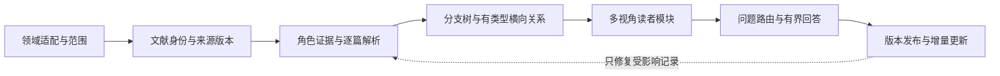

<div align="center">


# Survey for AI

### 为 AI 阅读、检索和持续更新而构建 Survey 的通用方法与 Skill。

[English](README.md) · **简体中文**

[打开在线示例](https://mr-tieguigui.github.io/survey-for-ai/) · [使用 Skill](skill/survey-evidence-ledger/SKILL.md) · [方法契约](method/workflow.json) · [AI 阅读指南](AI_GUIDE.md)

  

</div>

**Survey for AI 将一个领域的文献集合构造成 AI 可以按需读取的知识系统。** 项目的重点是一套可适配不同领域的构建方法、可复用 Skill 和检索契约：AI 根据读者的问题找到所需知识，理解结论边界，并追溯到正确版本的原文，而不必每次重新阅读整个领域。

**RSI（递归自我改进）是当前的展示实例。** 新领域通过领域适配器接入同一方法。当前版本完整展示了一个领域的整理过程；尚未据此证明所有领域均有效，也不宣称已经测得 token 节省比例或实现全球文献穷尽。

> **交付的是可复用知识系统：** 逐篇解析＋版本化证据＋领域关系＋读者模块＋有据可查的回答。网页负责展示，后续的叙述性论文可以建立在这些成果之上。

## 根据你的需求开始

| 我想做什么 | 从哪里进入 | 能得到什么 |
|---|---|---|
| 理解整套方法 | [构建流程](#整套方法如何运作) | 生命周期、证据权限和各阶段验收门槛 |
| 为另一个领域构建 Survey | [新领域快速开始](#为其他领域构建-survey) | 空白适配工作区和可执行的研究流程 |
| 把已有 Survey 交给 AI 使用 | [AI_GUIDE.md](AI_GUIDE.md) | 权威层级、按需检索和引用规则 |
| 看领域梳理的真实效果 | [RSI 领域图谱](https://mr-tieguigui.github.io/survey-for-ai/#atlas) | 纵向分支、关系连接、横向比较和需求阅读 |
| 查看具体论文 | [808 篇文献库](https://mr-tieguigui.github.io/survey-for-ai/explore/) | 具体机制、协议、限制、来源定位和证据深度 |
| 下载 RSI 的全部整合信息 | [完整信息包——需访问权限](https://github.com/Mr-Tieguigui/rsi-survey/raw/refs/heads/main/survey/RSI-Survey-Knowledge.zip) | 规范数据、808 张 Markdown、筛选记录、方法及查询工具 |

## 为什么要构建专门给 AI 阅读的 Survey？

一篇长文适合连续阅读。AI 回答一个具体研究问题时，还需要明确：**应该读取哪条记录、哪个版本支持结论、哪些对象可以比较，以及证据不足时应该在哪里停下。**

我们将这些判断保存在可查询的结构中：

| 读者问题 | 对应知识结构 | AI 可以怎么使用 |
|---|---|---|
| “这篇论文具体做了什么？” | 按角色展开的解析卡＋适用时的具体配置 | 一次读取机制、设定、结果及限制 |
| “这个方向是怎样发展过来的？” | 分支导航＋有类型、有方向的关系 | 沿有证据的转变阅读，区分比较与继承 |
| “哪些路线值得放在一起比较？” | 领域比较维度＋实验协议条件 | 比较可比设定，保留缺失项和不可比条件 |
| “我的任务应该优先看什么？” | 读者目标→问题→模块 | 读取所需切片，不加载所有论文 |
| “这句话可以作为技术结论引用吗？” | 准入主张→来源→版本→定位 | 返回有边界的断言和可追溯引用 |
| “增加一篇论文后，哪些内容需要更新？” | 版本化记录＋反向依赖 | 局部修复关联模块和答案 |

减少重复阅读、提高检索精度是结构设计目标。准确率、耗时和 token 的实际收益需要通过受控实验测量，当前不提供虚构的效率数字。

## 整套方法如何运作



| 步骤 | 形成什么 | 何时可以验收 |
|---|---|---|
| **01 · 定义领域** | 操作定义、角色、纳入排除、检索来源与截止、读者目标和预算 | 在大规模扩展前，固定成员单位和本轮验收范围 |
| **02 · 确认身份** | 文献家族、别名、DOI/arXiv 身份和独立来源版本 | 相似题名只作为候选关联；歧义和旧版本不被覆盖 |
| **03 · 提取证据** | 具体解析卡、角色主张、适用时的方法/协议配置 | 技术断言有对应正文依据，并保留 URL、版本、定位及限制 |
| **04 · 梳理领域** | 可导航的分支树和跨分支有类型关系 | 端点有效，依据支持具体谓词；引用或时间相邻不直接变成继承 |
| **05 · 按需综合** | 纵向、横向、机制、前沿和读者模块 | 每个模块能回到主张 ID，说明比较条件、解释和缺口 |
| **06 · 回答问题** | 根据读者问题选择的小规模证据包 | 绑定实际版本，区分有支持、部分支持和证据不足 |
| **07 · 维护与发布** | 依赖更新、完整性检查和版本清单 | 保留成员与历史，引用可解析，未完成门槛如实列出 |

机器可读的流程定义见 [method/workflow.json](method/workflow.json)；[领域接口](method/domain_interface.json)规定可替换的视图输入；[数据契约](skill/survey-evidence-ledger/references/data-contract.md)说明实体语义。

### 证据深度不能压成一个“已完成”标签

`已发现 → 已筛选 → 来源可访问 → 已阅读所需正文选段 → 有界主张准入`

它们代表不同权限：元数据支持身份和导航；摘要支持范围筛选与背景；具体正文阅读支持其对应的解释；准入主张才赋予相应技术引用权限。Benchmark、综述和背景文献可以有自己的角色证据，无需被强行改造成“具有改进循环的方法配置”。

**组织梳理就绪、严格原文审查全部完成、通用方法有效性已验证，是三件不同的事。** 尚未解决的文献继续保留，不通过删除失败项或改变阈值来制造完成。

## 同一套事实，多种理解方式

| 视角 | 回答什么 | 如何构建 |
|---|---|---|
| **纵向发展** | 问题如何变化、机制怎样推进、后续受到什么约束？ | 用分支组织问题，以有证据的演化关系连接节点；必要时允许多个前驱 |
| **横向比较** | 相邻方法、子领域和技术路线有哪些差异？ | 由适配器定义比较维度；评分比较保留任务、划分、指标、预算和选择条件 |
| **机制解析** | 方法或系统具体怎样工作？ | 连接输入、过程、输出、假设和失效条件；状态与反馈仅在适用系统中增加 |
| **前沿与缺口** | 当前检索范围中有哪些最新叶节点和未解问题？ | 绑定检索范围及截止；允许多个并列叶节点，不将局部叶节点说成全球最新 |
| **读者需求** | 新手、研究者、开发者、评价者分别应该读什么？ | 目标→问题→模块→依据→可选深入阅读 |
| **问答使用** | 现有证据到底能回答到什么程度？ | 返回断言、适用条件、来源、限制与缺失证据，必要时明确不作判断 |

**树提供入口，图保留完整关系。** 单一父节点的树无法表达的联系，由有类型的横向连接补充。组织分组、年代顺序、作者间技术继承和整理者比较分别标注。

## 为其他领域构建 Survey

可分发 Skill 为 [survey-evidence-ledger](skill/survey-evidence-ledger/SKILL.md)。它包含简洁入口、通用初始化工具、契约验证器、综合与问答规则、评估协议，以及独立的 RSI 适配说明。

**1. 获取方法与 Skill。** 克隆公开分发仓库，或下载其仓库 ZIP。AI 代理可以直接读取目录中的 Skill；这种使用方式不依赖特定提供商的安装命令。

```bash
git clone https://github.com/Mr-Tieguigui/survey-for-ai.git
cd survey-for-ai
python skill/survey-evidence-ledger/scripts/init_domain.py \
  --output ../my-survey --domain-id my-domain \
  --name "我的研究领域" --scope "明确的研究问题与边界"
```

**2. 完成领域适配。** 编辑 `../my-survey/method/domain_adapter.json`：设置纳入排除、检索来源与截止、角色证据字段、比较维度、关系谓词、读者需求和预算。初始化器创建的是**空白草稿**，不会生成虚构论文，也不会把初始化当成审查完成。

**3. 将任务明确交给 AI。**

```text
读取 skill/survey-evidence-ledger/SKILL.md，使用该流程构建 ../my-survey。
先根据已有信息完成领域适配并固定范围。
使用真实来源，保留准确身份、版本和证据深度。
构建逐篇解析、分支树与横向关系、比较和读者模块。
回答必须经过准入主张，保留缺口并从机器断点续跑。
连接与检查交给确定性工具，模型上下文只加载当前需要的证据。
```

**4. 整理、综合并检查。** 代理使用实际可用工具和来源完成语义研究。通用验证器只核对身份及引用结构，不能代替科学判断：

```bash
python skill/survey-evidence-ledger/scripts/validate_release.py ../my-survey/catalog
```

空工作区会有意地不通过发布就绪检查。新领域需要提供自己的字段映射和证据要求。初始化器与逻辑契约可迁移；完整 RSI 网页构建器及当前数据投影仍属于实例实现，不冒充已经泛化的网站生成器。

<details>
<summary><b>换一个领域，哪些需要修改，哪些应该保留？</b></summary>

| 按领域适配 | 保持不变的核心 |
|---|---|
| 术语、纳入排除标准 | 稳定文献身份和实际来源版本 |
| 文献角色、机制与评价字段 | 对应角色的正文依据和明确未知项 |
| 比较维度与协议兼容条件 | 有界主张、引用权限和结论限制 |
| 关系词汇与分支分类 | 端点证据，不把时间顺序当继承 |
| 读者、问题和模块 | 问题路由与可追溯回答 |
| 检索库、截止、更新节奏和预算 | 版本化状态、局部更新、如实验收 |

例如，检索方法与材料工艺两个领域可能需要完全不同的机制、评价字段。这是适配器的设计示例，并非已经完成的跨领域实验。

</details>

## AI 如何快速使用整理后的 Survey？

**检索路径：** `读者需求 → 问题索引 → 模块 → 准入主张 → 来源定位 → 按需展开解析卡或选段`。

完整 RSI 信息包提供无需模型、无需联网的局部查询：

```bash
python scripts/query.py "Darwin" --type papers --limit 3
python scripts/dossier.py wf_c29f716871f8031486
python scripts/dossier.py wf_c29f716871f8031486 --excerpts
```

请在解压后的 **RSI 完整信息包**中执行；公开展示仓库不包含私有规范账本。联合查询返回身份、具体配置、准入主张、关系、来源、限制和单独标明的定点补充；需要时才展开逐字选段。

回答契约包含：

```text
问题 / 语料版本 / 有界回答
主张 ID / 引用 {URL、版本、定位}
比较条件 / 结论限制 / 尚缺证据
状态：有支持 | 部分支持 | 证据不足
```

**真实实例：** 读者问“修改代理代码，是否也修改了生成后续改进的方法？”RSI 模块会取 DGM 与 Hyperagents 的具体配置及关系 `r_hyper_dgm`，比较其系统边界和选择条件，不将所有题名含“自我改进”的论文当成等价。可查看[在线横向比较](https://mr-tieguigui.github.io/survey-for-ai/#compare)与 [DGM 解析页](https://mr-tieguigui.github.io/survey-for-ai/papers/wf_c29f716871f8031486/)。

## RSI 实例：当前有哪些内容？

| 当前固定快照 | 数量 | 准确含义 |
|---|---:|---|
| 文献家族 / Markdown 解析卡 | **808** | 按角色整理的身份和阅读视图，不等于 808 篇整篇审查认证 |
| 方法配置 | **256** | 对应具体系统边界和评价协议 |
| 准入主张 | **745** | 使用各自已记录的引用权限与边界 |
| 有类型关系 | **198** | 其中 197 条当前具有可展示的原文支持 |
| 分支 / 读者模块 | **26 / 38** | 不同的组织与问题阅读入口 |
| 来源 / 证据记录 | **1,207 / 1,262** | 保留不同证据深度和历史记录 |
| 有保存正文选段的解析卡 | **509** | 逐字转录保留在有访问控制的信息包；公开页保留定位 |
| 有保存评价细节的解析卡 | **241** | 表示已有协议字段，不表示独立复现 |
| 严格原文计划 | **533 / 570** | **37 条来源、版本或定位例外仍保留** |

候选账本还包括 28,393 条发现记录和 1,072 项历史 P1 筛选记录。这些是候选及筛选的分母，不是额外纳入的论文数量。六项定点描述性阅读补充了具体机制和协议，也没有被计为六篇整篇复审。


## 怎样控制成本，同时保留准确性？

先读紧凑断点和本批变化；按实际 URL/版本复用来源缓存；同一所需选段提取一次，用稳定 ID 在多个视图复用。计数、连接、哈希和链接检查交给代码；身份歧义、机制、冲突及关系含义交给语义判断。复核者阅读变更及依据，避免重复整篇阅读。增量更新只修复受影响的依赖，并将实质批次统一构建。

当前不声称具体节省比例。[评估协议](skill/survey-evidence-ledger/references/evaluation-protocol.md)规定同模型、同来源对照，消融、未暴露迁移案例、引用保真、回答效用、实际取源次数、token、时间和维护修复。数据结构检查通过，不代表模型准确率提升已经得到证明。

## 文件、下载权限与持续维护

| 交付 | 包含什么 | 访问方式 |
|---|---|---|
| [公开方法与展示站点仓库](https://github.com/Mr-Tieguigui/survey-for-ai) | 中英双语介绍、Skill、方法契约、网站源码与 RSI 展示页面 | 公开 |
| [完整知识仓库](https://github.com/Mr-Tieguigui/rsi-survey) | 规范语料、证据、逐篇解析、筛选、索引、私有信息包和完整构建输入 | 需要仓库访问权限 |
| [独立 RSI 完整信息 ZIP](https://github.com/Mr-Tieguigui/rsi-survey/raw/refs/heads/main/survey/RSI-Survey-Knowledge.zip) | 全部整合知识；**排除网页、GitHub 配置、完整 PDF 和原始抓取缓存** | 需要仓库访问权限 |

完整信息包按 `catalog/`、`papers/`、`indexes/`、`screening/`、`method/`、`skill/`、`metadata/` 和离线查询工具组织，包内清单记录内容校验值。公开站点是阅读投影，不新增技术主张准入，也不分发原始论文逐字转录。

维护时先定位来源版本、受影响主张和模块；保留历史与真实冲突，检查变化及引用，最后更新清单。提出修正时，提供文献/来源 ID、准确定位、有界修改建议和受影响阅读入口即可。

**状态与权利。** 当前方法和 Skill 是已实现的候选版本，尚未完成跨领域受控有效性验证；本轮不写短篇论文。公开可访问不自动赋予代码、分析、元数据或第三方材料新的许可，详见 [LICENSE_STATUS.md](LICENSE_STATUS.md)。

**展示参考。** README 借鉴 [ARIS](https://github.com/wanshuiyin/Auto-claude-code-research-in-sleep) 的方法优先、清晰入口和渐进展开形式；具体流程、图形和 Survey 编排为本项目制作。实例网页的展示构造也参考了 [Ropedia W0](https://ropedia.github.io/ropedia-w0/)。
