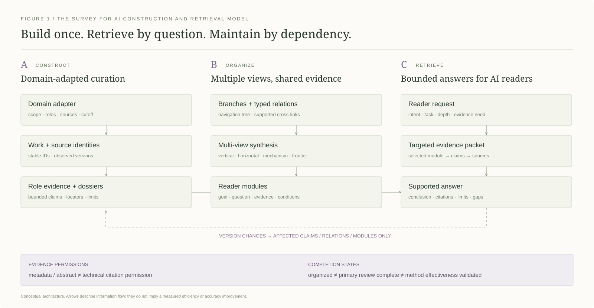
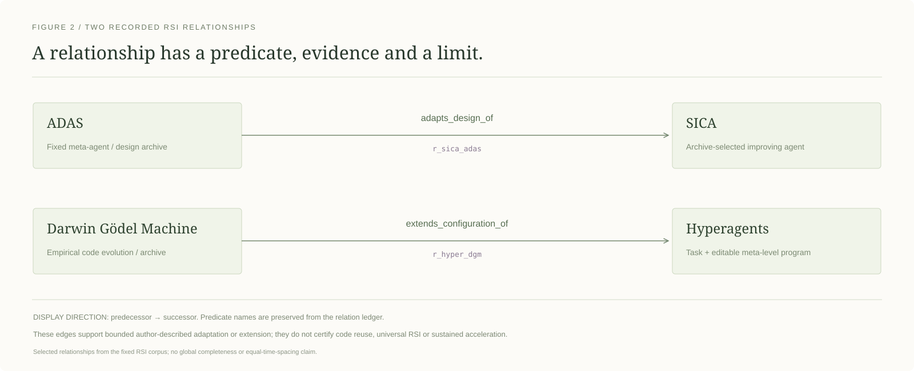

<div align="center">


# Survey for AI

### 为 AI 阅读、检索和持续更新而构建 Survey 的通用方法与 Skill。

[English](README.md) · **简体中文**

[打开在线示例](https://mr-tieguigui.github.io/survey-for-ai/) · [使用 Skill](skill/survey-evidence-ledger/SKILL.md) · [方法契约](method/workflow.json) · [AI 阅读指南](AI_GUIDE.md) · [项目动态](#news) · [新增 Survey](#为其他领域构建-survey) · [前沿方向目录](#frontier-directory)

  

</div>

🧠 **Survey for AI 将一个领域的文献集合构造成 AI 可以按需读取的知识系统。** 项目的重点是一套可适配不同领域的构建方法、可复用 Skill 和检索契约：AI 根据读者的问题找到所需知识，理解结论边界，并追溯到正确版本的原文，而不必每次重新阅读整个领域。

🔬 **RSI（递归自我改进）是当前的展示实例。** 新领域通过领域适配器接入同一方法。当前版本完整展示了一个领域的整理过程；尚未据此证明所有领域均有效，也不宣称已经测得 token 节省比例或实现全球文献穷尽。

> 📦 **交付的是可复用知识系统：** 逐篇解析＋版本化证据＋领域关系＋读者模块＋有据可查的回答。网页负责展示，后续的叙述性论文可以建立在这些成果之上。

<p align="center"><sub>◈ 方法与 Skill &nbsp; · &nbsp; ◎ RSI 展示实例 &nbsp; · &nbsp; 版本 v1.1.0 &nbsp; · &nbsp; 展示更新 2026-10-23</sub></p>

<a id="news"></a>

## 🗓️ 项目动态与路线图

> 🚀 **2026-10-23 · 项目公开发布。** 今天发布 **Survey for AI 的方法与可复用 Skill**，并提供 **RSI 领域实例**：[方法契约](method/workflow.json) · [Skill](skill/survey-evidence-ledger/SKILL.md) · [在线实例](https://mr-tieguigui.github.io/survey-for-ai/)。

| 时间 | 状态 | 发布内容 / 后续补充 |
|---|---|---|
| **2026-10-23** | ✅ 已发布 | **通用方法＋RSI 实例：**领域适配、版本化证据、有类型关系、读者模块与有界回答。 |
| **2026-10-23** | ✅ 已提供 | **双语项目展示：**中英文 README 与网站、学术图示、Evidence Atlas 标志及 01–10 统一章节导航。 |
| **2026-10-23** | ✅ 开放补充 | **新增 Survey 指引与[前沿目录](#frontier-directory)：**六个候选方向及自定义模板；预留位置不代表已完成新 Survey。 |
| **下一步 · 日期待定** | 🧩 待补充 | 从[开放方向](frontiers/README_CN.md)启动独立 Survey，适配契约，补充已核查证据与读者模块。 |
| **持续推进 · 无完成日期** | 🔎 证据待补 | 处理固定 RSI 严格原文计划中仍保留的 **37 条来源、版本或定位例外**，如实展示现有边界。 |
| **计划中 · 日期待定** | 🧪 待评估 | 按[受控协议](skill/survey-evidence-ledger/references/evaluation-protocol.md)衡量跨领域迁移、引用保真、回答质量、token 消耗和维护成本。 |
| **计划中 · 日期待定** | 📝 后续写作 | 在评价与证据准备充分后，形成方法短篇论文。 |

*已发布与待补充分别标注；后续日期待定。*

<a id="一眼看懂项目"></a>

## 🧭 一眼看懂项目

| ◇ 通用方法 | ⌘ 可复用 Skill | ◎ 实例 | ↔ 双语界面 |
|---|---|---|---|
| 领域适配、证据权限、类型关系和回答契约 | 初始化、整理、综合、检索与增量维护 | 固定范围的 RSI 语料，明确各层证据深度 | [中文网站](https://mr-tieguigui.github.io/survey-for-ai/) · [English website](https://mr-tieguigui.github.io/survey-for-ai/en/) |

<figure>

</figure>

*图 1．概念性构建与检索模型。底部证据边界区分导航信息与技术引用权限；返回路径表示局部维护，不代表已经测得的效率提升。*

<a id="根据你的需求开始"></a>

## 🎯 根据你的需求开始

| 我想做什么 | 从哪里进入 | 能得到什么 |
|---|---|---|
| 理解整套方法 | [构建流程](#整套方法如何运作) | 生命周期、证据权限和各阶段验收门槛 |
| 为另一个领域构建 Survey | [新领域快速开始](#为其他领域构建-survey) | 空白适配工作区和可执行的研究流程 |
| 把已有 Survey 交给 AI 使用 | [AI_GUIDE.md](AI_GUIDE.md) | 权威层级、按需检索和引用规则 |
| 选择或提出新方向 | [前沿目录](#frontier-directory) | 六个候选范围、待认领位置与通用模板 |
| 看领域梳理的真实效果 | [RSI 领域图谱](https://mr-tieguigui.github.io/survey-for-ai/atlas/) | 纵向分支、关系连接、横向比较和需求阅读 |
| 查看具体论文 | [808 篇文献库](https://mr-tieguigui.github.io/survey-for-ai/explore/) | 具体机制、协议、限制、来源定位和证据深度 |
| 下载 RSI 的全部整合信息 | [完整信息包——需访问权限](https://github.com/Mr-Tieguigui/rsi-survey/raw/refs/heads/main/survey/RSI-Survey-Knowledge.zip) | 规范数据、808 张 Markdown、筛选记录、方法及查询工具 |

<a id="为什么要构建专门给-ai-阅读的-survey"></a>

## 💡 为什么要构建专门给 AI 阅读的 Survey？

一篇长文适合连续阅读。AI 回答一个具体研究问题时，还需要明确：**应该读取哪条记录、哪个版本支持结论、哪些对象可以比较，以及证据不足时应该在哪里停下。**

我们将这些判断保存在可查询的结构中：

| 读者问题 | 对应知识结构 | AI 可以怎么使用 |
|---|---|---|
| “这篇论文具体做了什么？” | 按角色展开的解析卡＋适用时的具体配置 | 一次读取机制、设定、结果及限制 |
| “这个方向是怎样发展过来的？” | 分支导航＋有类型、有方向的关系 | 沿有证据的转变阅读，区分比较与继承 |
| “哪些路线值得放在一起比较？” | 领域比较维度＋实验协议条件 | 比较可比设定，保留缺失项和不可比条件 |
| “我的任务应该优先看什么？” | 读者目标→问题→模块 | 读取所需切片，不加载所有论文 |
| “这句话可以作为技术结论引用吗？” | 准入主张→来源→版本→定位 | 返回有边界的断言和可追溯引用 |
| “增加一篇论文后，哪些内容需要更新？” | 版本化记录＋反向依赖 | 局部修复关联模块和答案 |

减少重复阅读、提高检索精度是结构设计目标。准确率、耗时和 token 的实际收益需要通过受控实验测量，当前不提供虚构的效率数字。

<a id="整套方法如何运作"></a>

## 🧩 整套方法如何运作


| 步骤 | 形成什么 | 何时可以验收 |
|---|---|---|
| **01 · 定义领域** | 操作定义、角色、纳入排除、检索来源与截止、读者目标和预算 | 在大规模扩展前，固定成员单位和本轮验收范围 |
| **02 · 确认身份** | 文献家族、别名、DOI/arXiv 身份和独立来源版本 | 相似题名只作为候选关联；歧义和旧版本不被覆盖 |
| **03 · 提取证据** | 具体解析卡、角色主张、适用时的方法/协议配置 | 技术断言有对应正文依据，并保留 URL、版本、定位及限制 |
| **04 · 梳理领域** | 可导航的分支树和跨分支有类型关系 | 端点有效，依据支持具体谓词；引用或时间相邻不直接变成继承 |
| **05 · 按需综合** | 纵向、横向、机制、前沿和读者模块 | 每个模块能回到主张 ID，说明比较条件、解释和缺口 |
| **06 · 回答问题** | 根据读者问题选择的小规模证据包 | 绑定实际版本，区分有支持、部分支持和证据不足 |
| **07 · 维护与发布** | 依赖更新、完整性检查和版本清单 | 保留成员与历史，引用可解析，未完成门槛如实列出 |

机器可读的流程定义见 [method/workflow.json](method/workflow.json)；[领域接口](method/domain_interface.json)规定可替换的视图输入；[数据契约](skill/survey-evidence-ledger/references/data-contract.md)说明实体语义。

### 🔎 证据深度不能压成一个“已完成”标签

`已发现 → 已筛选 → 来源可访问 → 已阅读所需正文选段 → 有界主张准入`

它们代表不同权限：元数据支持身份和导航；摘要支持范围筛选与背景；具体正文阅读支持其对应的解释；准入主张才赋予相应技术引用权限。Benchmark、综述和背景文献可以有自己的角色证据，无需被强行改造成“具有改进循环的方法配置”。

**组织梳理就绪、严格原文审查全部完成、通用方法有效性已验证，是三件不同的事。** 尚未解决的文献继续保留，不通过删除失败项或改变阈值来制造完成。

<a id="同一套事实多种理解方式"></a>

## 🗺️ 同一套事实，多种理解方式

| 视角 | 回答什么 | 如何构建 |
|---|---|---|
| **纵向发展** | 问题如何变化、机制怎样推进、后续受到什么约束？ | 用分支组织问题，以有证据的演化关系连接节点；必要时允许多个前驱 |
| **横向比较** | 相邻方法、子领域和技术路线有哪些差异？ | 由适配器定义比较维度；评分比较保留任务、划分、指标、预算和选择条件 |
| **机制解析** | 方法或系统具体怎样工作？ | 连接输入、过程、输出、假设和失效条件；状态与反馈仅在适用系统中增加 |
| **前沿与缺口** | 当前检索范围中有哪些最新叶节点和未解问题？ | 绑定检索范围及截止；允许多个并列叶节点，不将局部叶节点说成全球最新 |
| **读者需求** | 新手、研究者、开发者、评价者分别应该读什么？ | 目标→问题→模块→依据→可选深入阅读 |
| **问答使用** | 现有证据到底能回答到什么程度？ | 返回断言、适用条件、来源、限制与缺失证据，必要时明确不作判断 |

**树提供入口，图保留完整关系。** 单一父节点的树无法表达的联系，由有类型的横向连接补充。组织分组、年代顺序、作者间技术继承和整理者比较分别标注。

<a id="为其他领域构建-survey"></a>

## 🛠️ 为其他领域构建 Survey

**选择方向 → 初始化草稿 → 适配证据契约 → 整理论文 → 综合知识 → 验收与发布。** 通用方法和 [Skill](skill/survey-evidence-ledger/SKILL.md) 负责流程；新领域提供自己的定义、证据字段与比较标准。

### 🔭 1 · 选择预留方向，或定义自己的领域

查看[前沿目录](frontiers/README_CN.md)。每个候选方向都有独立的范围文件与一手发现入口。新增未列出的领域时，将 [`frontiers/_template/`](frontiers/_template/) 复制到 `frontiers/<domain-id>/`，修改 `scope.json`，并将相对路径登记到 [`registry.json`](frontiers/registry.json)。ID 使用小写字母、数字和连字符。这些是**原文审查数为零的规划起点**，不是已经完成的 Survey。

### 📁 2 · 创建真正的 Survey 工作区

克隆后，在仓库根目录执行：

```bash
git clone https://github.com/Mr-Tieguigui/survey-for-ai.git
cd survey-for-ai
python skill/survey-evidence-ledger/scripts/init_domain.py \
  --output frontiers/agent-memory/survey --domain-id agent-memory \
  --name "Agent Memory" --scope "External agent memory: retention, retrieval and cross-task evaluation"
```

替换成你的领域 ID、名称、研究问题和输出位置。父目录保存方向提案，`survey/` 子目录保存实际研究记录。初始化器只接受全新或空白目标，遇到已有 Survey 会拒绝覆盖。执行这条命令**不会**自动检索论文、准入主张或生成网站。

### 🧩 3 · 先适配领域契约，再批量收集

编辑 `frontiers/agent-memory/survey/method/domain_adapter.json`：

| 要决定什么 | 写入适配器 | 智能体记忆示例——候选范围 |
|---|---|---|
| 哪些工作属于本领域？ | 定义、纳入排除、来源与截止 | 区分外部保留状态与模型权重训练 |
| 每篇需要什么依据？ | 方法、benchmark、理论和背景的角色字段 | 记忆表示、读写规则、保留周期、评价与限制 |
| 什么可以横向比较？ | 比较轴与协议兼容条件 | 跨任务划分、基础模型、上下文、工具和计算预算 |
| 工作之间怎样连接？ | 分支词汇与有类型关系 | 区分比较、机制相似与有证据的技术继承 |
| 谁来使用？ | 读者画像与可回答问题 | 实现者：哪种状态和检索策略适配具体任务？ |
| 本轮完成到什么程度？ | 预算、完成单位与访问范围 | 固定语料和证据目标，单独保留未决项 |

方向的 `scope.json` 是规划输入；初始化后的适配器是执行契约；`catalog/` 和已存证据决定哪些内容得到支持。与 RSI 有主题重叠，不会自动继承主张引用权限，也不会增加 RSI 的收录数量。

### 🤖 4 · 给 AI 一份具体任务

让代理直接读取仓库内的 Skill，无需先执行某个平台专属的安装命令。先用小规模试跑检查字段，再固定批次范围。

```text
读取 skill/survey-evidence-ledger/SKILL.md。
以 frontiers/agent-memory/scope.json 为规划输入，构建 frontiers/agent-memory/survey。
完成领域适配器，明确记录范围、来源、截止和预算。
使用真实身份、准确来源版本、角色专属证据和结论限制。
发现入口与技术准入分开；不编造论文、评价结果或完成状态。
形成逐篇解析、分支、有类型横向关系、比较维度和读者模块。
回答包含有界结论、主张 ID、引用、适用条件与缺口。
从 work/run_state.json 续跑，复用已存证据，仅修复受影响记录。
```

### 🗂️ 5 · 交付人和 AI 都能检查的知识

```text
frontiers/<domain-id>/
├── scope.json                  # 候选方向、问题与发现入口
├── README.md                   # 自动生成的双语方向说明
└── survey/                     # 真正启动研究后才创建
    ├── method/domain_adapter.json
    ├── catalog/                # 文献、版本、证据、主张、关系和模块
    ├── papers/                 # 逐篇具体解析
    ├── indexes/                # 读者与问题入口
    └── work/run_state.json     # 可恢复断点与未决判断
```

### ✅ 6 · 验收后，再提升状态

```bash
python skill/survey-evidence-ledger/scripts/validate_release.py frontiers/agent-memory/survey/catalog
python scripts/build_frontier_index.py
python scripts/build_frontier_index.py --check
```

第一条命令检查通用数据契约及引用，空草稿会有意地不通过发布就绪。科学准确性仍需对应角色的证据复核，以及关系和回答的语义检查。后两条命令无需模型或联网，用于更新和核对双语目录。只有实际工作存在，才能在 `scope.json` 中依次提升 `proposed → scoped → curating → synthesizing → ready`。发布时记录固定范围、截止、证据深度及仍未关闭的事项。

**网页接入是单独的一步。** 通用初始化器和数据契约可迁移；当前 RSI 网页投影属于实例实现，新领域还需对应的数据与视图适配器。是否发布以及是否公开新语料，需要单独确定访问范围。

<a id="frontier-directory"></a>

<a id="前沿-survey开放扩展目录"></a>

## 🔭 前沿 Survey：开放扩展目录

以下是**策展者提出的未来 Survey 候选**，不是“最新领域排行榜”，也不是已完成的跨领域验证。种子链接已于 **2026-10-23** 核对为一手发现入口；这不等于正文审查，也不代表完整文献检索截止。六个位置均待认领，可在范围固定前调整。

<!-- frontier-directory:start -->
| 编号 | 候选方向 | 核心研究问题 | 状态 | 文件夹 |
|---|---|---|---|---|
| F01 | 智能体记忆与持续学习 | 外部记忆如何影响后续任务，怎样评估真实迁移？ | ○ 待启动 | [agent-memory](frontiers/agent-memory/) |
| F02 | 测试时计算、推理与适配 | 额外推理预算和测试时更新分别带来什么变化？ | ○ 待启动 | [test-time-adaptation](frontiers/test-time-adaptation/) |
| F03 | 科学发现与研究智能体 | 从研究问题到候选结果，哪些环节有可复核证据？ | ○ 待启动 | [scientific-discovery](frontiers/scientific-discovery/) |
| F04 | 世界模型与具身交互 | 可生成、可预测和可交互的环境模型分别支持什么？ | ○ 待启动 | [world-models](frontiers/world-models/) |
| F05 | 智能体评测与可靠性 | 怎样区分模型、环境、harness 与评价协议的贡献？ | ○ 待启动 | [agent-evaluation](frontiers/agent-evaluation/) |
| F06 | 多智能体协作与组织 | 协作结构怎样影响任务分解、通信和执行结果？ | ○ 待启动 | [multi-agent-systems](frontiers/multi-agent-systems/) |
| ＋ | **你的领域** | 提出范围与读者问题 | 开放补充 | [_template](frontiers/_template/) |
<!-- frontier-directory:end -->

➕ **为你的领域留一个位置。** 开放模板行可继续加入 AI 或非 AI 领域。详见[中文目录](frontiers/README_CN.md) · [English directory](frontiers/README.md) · [机器注册表](frontiers/registry.json)。RSI 实例和未来每个 Survey 分别管理自己的版本与范围。

<a id="ai-如何快速使用整理后的-survey"></a>

## 🤖 AI 如何快速使用整理后的 Survey？

🔎 **检索路径：** `读者需求 → 问题索引 → 模块 → 准入主张 → 来源定位 → 按需展开解析卡或选段`。

完整 RSI 信息包提供无需模型、无需联网的局部查询：

```bash
python scripts/query.py "Darwin" --type papers --limit 3
python scripts/dossier.py wf_c29f716871f8031486
python scripts/dossier.py wf_c29f716871f8031486 --excerpts
```

请在解压后的 **RSI 完整信息包**中执行；公开展示仓库不包含私有规范账本。联合查询返回身份、具体配置、准入主张、关系、来源、限制和单独标明的定点补充；需要时才展开逐字选段。

回答契约包含：

```text
问题 / 语料版本 / 有界回答
主张 ID / 引用 {URL、版本、定位}
比较条件 / 结论限制 / 尚缺证据
状态：有支持 | 部分支持 | 证据不足
```

💬 **真实实例：** 读者问“修改代理代码，是否也修改了生成后续改进的方法？”RSI 模块会取 DGM 与 Hyperagents 的具体配置及关系 `r_hyper_dgm`，比较其系统边界和选择条件，不将所有题名含“自我改进”的论文当成等价。可查看[在线横向比较](https://mr-tieguigui.github.io/survey-for-ai/compare/)与 [DGM 解析页](https://mr-tieguigui.github.io/survey-for-ai/papers/wf_c29f716871f8031486/)。

<a id="代表论文展示不同工作承担什么角色"></a>

## 📚 代表论文展示：不同工作承担什么角色？

以下选择用于展示不同角色与机制，不是排行榜，也不为每篇赋予整篇审查认证。版本链接指向本次记录实际采用的来源。

| 年份 | 论文 / 实际来源 | 研究角色 | 保留对象与阅读边界 |
|---|---|---|---|
| 2003 | [Gödel Machine](https://arxiv.org/html/cs/0309048v5) · `v5` | 理论 / 形式系统 | 给定形式系统与效用假设下的可证明改写 |
| 2025 | [Absolute Zero](https://arxiv.org/html/2505.03335v3) · `v3` | 方法 | 共享策略训练；任务缓冲区与参数保留 |
| 2023 | [Voyager](https://arxiv.org/html/2305.16291v2) · `v2` | 方法 | 跨任务复用的可执行技能 |
| 2023 | [ExpeL](https://arxiv.org/html/2308.10144v3) · `v3` | 方法 | 在后续提示中检索经验规则 |
| 2024 | [ADAS](https://arxiv.org/html/2408.08435v2) · `v2` | 系统 / 智能体 | 归档目标代理设计；元代理固定 |
| 2025 | [SICA](https://arxiv.org/html/2504.15228v2) · `v2` | 方法 | 选择归档编码代理参与后续改进 |
| 2025 | [Darwin Gödel Machine](https://arxiv.org/html/2505.22954v3) · `v3` | 方法 | 代理源码演化；经验评价与形式证明分开 |
| — | [Raven](https://github.com/EverMind-AI/Raven/releases/download/tech-report-v1/technical-report.pdf) · `tech-report-v1` | 系统 / 智能体 | Harness 策略适配；训练选择与密封测试分开 |



*图 2．展示方向为前驱到后继，保留关系账本的谓词与 ID；两条边均不构成通用 RSI 或持续加速的证据。*

<a id="rsi-实例当前有哪些内容"></a>

## 🔬 RSI 实例：当前有哪些内容？

| 当前固定快照 | 数量 | 准确含义 |
|---|---:|---|
| 文献家族 / Markdown 解析卡 | **808** | 按角色整理的身份和阅读视图，不等于 808 篇整篇审查认证 |
| 方法配置 | **256** | 对应具体系统边界和评价协议 |
| 准入主张 | **745** | 使用各自已记录的引用权限与边界 |
| 有类型关系 | **198** | 其中 197 条当前具有可展示的原文支持 |
| 分支 / 读者模块 | **26 / 38** | 不同的组织与问题阅读入口 |
| 来源 / 证据记录 | **1,207 / 1,262** | 保留不同证据深度和历史记录 |
| 有保存正文选段的解析卡 | **509** | 逐字转录保留在有访问控制的信息包；公开页保留定位 |
| 有保存评价细节的解析卡 | **241** | 表示已有协议字段，不表示独立复现 |
| 严格原文计划 | **533 / 570** | **37 条来源、版本或定位例外仍保留** |

候选账本还包括 28,393 条发现记录和 1,072 项历史 P1 筛选记录。这些是候选及筛选的分母，不是额外纳入的论文数量。六项定点描述性阅读补充了具体机制和协议，也没有被计为六篇整篇复审。


<a id="怎样控制成本同时保留准确性"></a>

## ⚡ 怎样控制成本，同时保留准确性？

先读紧凑断点和本批变化；按实际 URL/版本复用来源缓存；同一所需选段提取一次，用稳定 ID 在多个视图复用。计数、连接、哈希和链接检查交给代码；身份歧义、机制、冲突及关系含义交给语义判断。复核者阅读变更及依据，避免重复整篇阅读。增量更新只修复受影响的依赖，并将实质批次统一构建。

当前不声称具体节省比例。[评估协议](skill/survey-evidence-ledger/references/evaluation-protocol.md)规定同模型、同来源对照，消融、未暴露迁移案例、引用保真、回答效用、实际取源次数、token、时间和维护修复。数据结构检查通过，不代表模型准确率提升已经得到证明。

<a id="项目阅读地图"></a>

## 🧭 项目阅读地图

建议顺序：**[框架](https://mr-tieguigui.github.io/survey-for-ai/) → [方法](https://mr-tieguigui.github.io/survey-for-ai/method/) → [Skill](https://mr-tieguigui.github.io/survey-for-ai/skill/) → [RSI 概览](https://mr-tieguigui.github.io/survey-for-ai/rsi/) → [图谱](https://mr-tieguigui.github.io/survey-for-ai/atlas/) → [案例](https://mr-tieguigui.github.io/survey-for-ai/cases/) → [比较](https://mr-tieguigui.github.io/survey-for-ai/compare/) → [需求问答](https://mr-tieguigui.github.io/survey-for-ai/reader/)**。语言切换保持当前页面。主界面和代表导读为双语，档案保留原始整理语言。

<a id="文件下载权限与持续维护"></a>

## 📦 文件、下载权限与持续维护

| 交付 | 包含什么 | 访问方式 |
|---|---|---|
| [公开方法与展示站点仓库](https://github.com/Mr-Tieguigui/survey-for-ai) | 中英双语介绍、Skill、方法契约、网站源码与 RSI 展示页面 | 公开 |
| [完整知识仓库](https://github.com/Mr-Tieguigui/rsi-survey) | 规范语料、证据、逐篇解析、筛选、索引、私有信息包和完整构建输入 | 需要仓库访问权限 |
| [独立 RSI 完整信息 ZIP](https://github.com/Mr-Tieguigui/rsi-survey/raw/refs/heads/main/survey/RSI-Survey-Knowledge.zip) | 全部整合知识；**排除网页、GitHub 配置、完整 PDF 和原始抓取缓存** | 需要仓库访问权限 |

完整信息包按 `catalog/`、`papers/`、`indexes/`、`screening/`、`method/`、`skill/`、`metadata/` 和离线查询工具组织，包内清单记录内容校验值。公开站点是阅读投影，不新增技术主张准入，也不分发原始论文逐字转录。

维护时先定位来源版本、受影响主张和模块；保留历史与真实冲突，检查变化及引用，最后更新清单。提出修正时，提供文献/来源 ID、准确定位、有界修改建议和受影响阅读入口即可。

**状态与权利。** 当前方法和 Skill 是已实现的候选版本，尚未完成跨领域受控有效性验证。公开可访问不自动赋予代码、分析、元数据或第三方材料新的许可，详见 [LICENSE_STATUS.md](LICENSE_STATUS.md)。

**展示参考。** README 借鉴 [ARIS](https://github.com/wanshuiyin/Auto-claude-code-research-in-sleep) 的方法优先、清晰入口和渐进展开形式；具体流程、图形和 Survey 编排为本项目制作。实例网页的展示构造也参考了 [Ropedia W0](https://ropedia.github.io/ropedia-w0/)。
